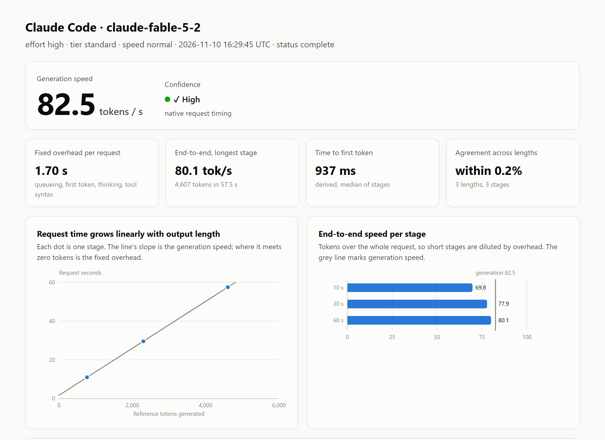
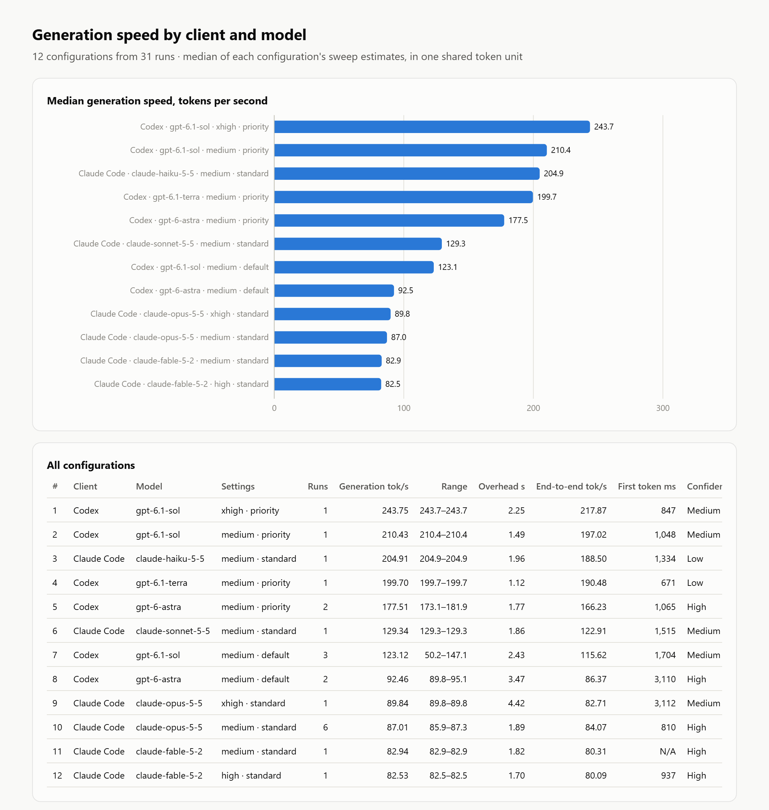
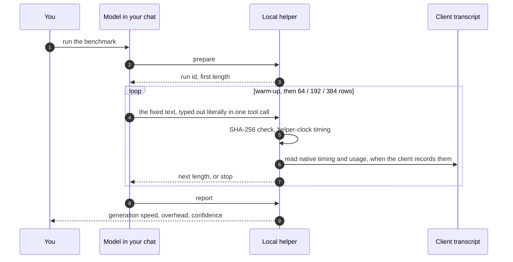

<div align="center">

# Chat Benchmark

**Measure how fast the model in your current chat really generates, in any agent CLI.**

One shared token unit · overhead separated from speed · a confidence level on every result


<picture>
  <source media="(prefers-color-scheme: dark)" srcset="docs/images/report-dark.png">
  
</picture>

</div>

Say **"run the benchmark"** inside Claude Code, Codex, Kimi Code, Antigravity (`agy`), Grok, Gemini CLI, OpenCode, pi, Cursor Agent, Copilot CLI, Droid, Qwen Code, Goose or any other agent CLI. Two to three minutes later you get the generation speed of that chat's own model, with its active effort, speed and tier. No other process or API call produces the samples.

## Why another TPS number

The usual figure, output tokens divided by request seconds, is not a property of the model. It is diluted by everything around generation (queueing, time to first token, thinking, tool-call syntax, client latency), so it rises with output length and differs between clients for reasons that have nothing to do with speed.

One real run, one model, three output lengths:

| Stage | Tokens | Request time | Tokens ÷ time |
|---|---:|---:|---:|
| 10 s | 767 | 10.99 s | 69.8 tok/s |
| 30 s | 2,303 | 29.58 s | 77.9 tok/s |
| 60 s | 4,607 | 57.52 s | 80.1 tok/s |

Three different answers. Fit a line through the same three points instead and every pair of lengths agrees on **82.5 tok/s within 0.2%**, with 1.70 s of fixed overhead per request. That slope is what this tool reports.

## Quick start

```bash
python -m pip install -r requirements.txt
python benchmark.py install     # adds the skill to every agent CLI found on this machine
python benchmark.py selftest    # proves the pipeline here in about 10 seconds
```

Restart the client once, then in any chat:

| Client | Start with |
|---|---|
| Most clients | `run the benchmark` or `/chat-benchmark` |
| Codex | `$chat-benchmark` |
| Kimi Code, pi | `/skill:chat-benchmark` |
| A CLI without skills | ask it to follow `~/.chat-benchmark/runtime/skills/SKILL.template.md` with `--provider <name>` |

Requires Python 3.11+ and the pinned `tiktoken`. The reference tokenizer is bundled and hash-verified; nothing is downloaded at run time.

## What you get

The chat ends with a summary like this (a real run):

> **Claude Code** · model `claude-fable-5-2` · effort `high` · tier `standard`
>
> | Result | Value |
> |---|---:|
> | **Generation speed** | **82.53 tok/s** |
> | Agreement across lengths | within 0.2% (3 lengths) |
> | Fixed overhead per request | 1.70 s |
> | End-to-end at 4,607 tokens | 80.09 tok/s |
> | Time to first token, median | 937 ms (derived) |
> | Confidence | High · native request timing |
>
> Confidence basis: 3 reference lengths agree within 0.2%; native and helper-clock estimates agree within 2.1%.

Every run also saves `benchmark.html` (the report above), `benchmark.md`, `benchmark.json`, `benchmark.csv` and `chat.md` under `~/.chat-benchmark/results/`.

### Compare everything you have measured

```bash
python benchmark.py compare          # Markdown leaderboard
python benchmark.py compare --open   # the same as an HTML page
```

<div align="center">
<picture>
  <source media="(prefers-color-scheme: dark)" srcset="docs/images/leaderboard-dark.png">
  
</picture>
</div>

Rows are comparable across providers because every run counts the same verified text with the same tokenizer. Screenshots show real runs from the development machine.

## How it works



**Fixed text.** Every line is `NNNN amber birch cedar delta ember frost grove harbor`, restarting at 0001 per sample. A hash check rejects any changed, missing or added character. The verified text is counted with one frozen `o200k_base` tokenizer, so identical text is the same number of tokens for every provider (64 / 192 / 384 rows are 767 / 2,303 / 4,607 tokens). Provider-native counts are kept separately for usage and cost.

**The fit.** Request time is close to `overhead + tokens / speed`. A Theil-Sen line (the median of pairwise slopes) through the stages gives speed as the slope and overhead as the intercept, and one stalled request cannot drag it.

**Two clocks.**

| Clock | Available for | What it measures |
|---|---|---|
| Native request timing | Clients with an adapter | Request start to stream end, plus exact token usage, model and effort, read from the client's own transcript |
| Helper clock | Every client | The gap between the helper's own exit and its next start, which brackets exactly one model response |

The helper clock includes client and tool-dispatch overhead, but that overhead is constant per stage and cancels in the slope. When both clocks exist they are fitted independently and compared. On the run above they landed 2.1% apart.

**Confidence is earned, not asserted.**

| Level | When |
|---|---|
| High | Three or more lengths agree within 5% and nothing was flagged |
| Medium | Lengths agree within 15%, or a check could not run (no transcript, thinking varied between stages, the two clocks disagree by more than 10%) |
| Low | Only two lengths ran, or lengths disagree by more than 15% |

`--preset precise` runs each length twice in mirrored order (10, 30, 60, 60, 30, 10), which cancels slow drift and adds a bootstrap 95% interval. Expect 5 to 7 minutes.

## Supported clients

| Client | Key | Native data | Samples on Windows |
|---|---|---|---|
| Claude Code | `claude` | timing, usage, settings, tool-argument stream time; TTFT with telemetry | shell stdin |
| Codex | `codex` | timing, usage, settings; TTFT with telemetry | shell stdin |
| Kimi Code | `kimi` | timing, usage, settings, TTFT, stream time | file |
| Antigravity CLI | `agy` | timing, usage incl. thinking tokens, model | file |
| Grok CLI | `grok` | timing, usage, settings, first-chunk latency | shell stdin |
| OpenCode | `opencode` | timing, usage, settings, first-event latency | file |
| pi | `pi` | timing, usage, settings, client cost estimate | file |
| Gemini CLI · Qwen Code · Cursor Agent · Copilot CLI · Droid · Goose · Augment · iFlow · CodeBuddy | `gemini` `qwen` `cursor` `copilot` `droid` `goose` `auggie` `iflow` `codebuddy` | helper clock | file (Cursor: stdin) |
| Anything else | any name | helper clock | file |

On macOS and Linux every client uses shell stdin. `python benchmark.py providers` prints this table for your machine, including what is detected and installed.

<details>
<summary><b>Adapters, detection and delivery in detail</b></summary>

- **Any other CLI** works without an adapter: `prepare --provider <name>`, with optional `--model` and `--effort` labels. Labels are self-reported and used only when the client records nothing.
- **Sample delivery.** `stdin` sends the rows as literal shell input in one tool call. `file` has the model create the sample with the client's own file tool inside `./.chat-benchmark-tmp/` (removed afterwards) and then call the helper. It is the default wherever a shell is known or suspected to cut long commands; Git Bash on Windows stops near 8,191 characters. Override with `--delivery`.
- **Client detection.** Clients load each other's skill folders, so the skill's `--provider` hint is checked against the parent-process chain and the real client wins. A chat is never chosen by recency. When a client exposes no session id, the transcript is matched by the run's random id after the first sample.
- **Verified versions.** Adapters were checked against real sessions of Claude Code 2.1.3xx, Codex 0.16x, Kimi Code 2.5, agy 1.4/1.5, Grok 1.0.52, OpenCode 1.18 and pi 0.84. If a client changes its format, the adapter yields nothing and the run continues on the helper clock instead of failing.
- **Install options.** `install --clients kimi,agy` limits the install, `--all-clients` includes clients not detected, `--clients agents` adds the shared `~/.agents/skills` folder, and `--no-telemetry` leaves Codex and Claude Code settings untouched.

</details>

## What makes a sample invalid

- The text differs from the reference (hash mismatch).
- More than one tool call in the response.
- The rows are not literally in the tool-call arguments, or the native output token count is too small to contain them. A script wrote the text, not the model.
- Model, effort or tier changed mid-run, or the context was compacted.

A sample cut off by a shell that truncates long commands is detected and reported without recording anything. Without a transcript the hash is still verified, but call structure and literal generation cannot be, so confidence is capped at medium.

## Commands

| Command | Purpose |
|---|---|
| `install` | Copy the runtime and add the skill for detected clients |
| `doctor` | What is installed, what each client exposes, the current chat |
| `providers` | Client capability table |
| `selftest` | Drive the real commands with a simulated client of known speed |
| `compare` | Leaderboard across clients and models (`--open` for HTML, `--json`) |
| `history` | Per-stage history grouped by client, settings, context size and cache band |
| `report --run-id ID` | Re-render a run (`--chat`, `--json`, `--open`) |
| `prepare` · `write-sample` · `status` | The protocol the skill drives; rarely typed by hand |

```bash
python benchmark.py prepare --provider auto --preset precise
python benchmark.py prepare --durations 10,20,30 --max-seconds 180
python benchmark.py report --run-id RUN_ID --open
```

<details>
<summary><b>Protocol, budgets and files</b></summary>

The standard sweep takes roughly 2 to 3 minutes: a nominal 5-second warm-up (32 rows, excluded from every aggregate), then nominal 10/30/60-second stages. Stage labels select fixed lengths; actual seconds depend on the model.

A wall budget (180 s standard, 480 s precise) is checked between stages, and active output is never cut off. If the next stage would not fit, a shorter fixed stage (45, 40, 30, 25, 20 or 15 s) is substituted so the sweep still has three lengths, and the report says so. `--strict-stages` disables that. No sleeping or artificial elapsed time is used. Limits are 6,000 words per sample and 10,000 per standard sweep.

Each sample checkpoints every report file and the run manifest. Identical retries are idempotent. Settings changes, compaction, mismatches, synthesized text and exhausted budgets produce explicit stop reasons.

**Files.** With stdin delivery the helper writes the text to an owned directory under the OS temp folder, validates it and deletes it before returning. Cleanup checks resolved paths and ownership and never deletes anything it did not create. Abandoned directories are recovered by a later `prepare`. Metrics and hashes persist; sample text does not. Tool arguments remain in the client's own history as usual.

**Accounting** totals all observed requests from `prepare` onward, as reported by the client. Dollar figures, when a client exposes them, are client estimates and not invoice charges; no price schedule is ever assumed. Reference tokens must never be multiplied by a token price.

**Telemetry receiver.** For Codex and Claude Code, `install` points their OpenTelemetry export at a local receiver on `127.0.0.1:43189`, which adds native TTFT. It starts on demand, exits after 20 idle minutes, stores only allowlisted timing, usage and settings fields for 14 days, and never stores prompts or output. Original configs are backed up and existing telemetry destinations are preserved. Without it everything still works; Claude Code then shows a derived first-token latency.

</details>

## What this does not measure

- **Per-token gaps and exact first-visible-token latency.** No client exposes them.
- **Engine decode speed in isolation.** Generation speed is what this client delivers for tool-argument output under current load.
- **Tail latency.** Three or six requests describe one run. Use `compare` and `history` across runs for stability over time.

## Project layout

```
benchmark.py              entry point
chat_benchmark/
  cli.py                  commands and the run protocol
  estimate.py  sweep.py   the length-sweep fit and confidence grading
  clock.py  ancestry.py   helper-clock timing, client detection by process chain
  providers.py            client registry, session binding
  sessions.py adapters.py transcript readers (Claude Code, Codex, Kimi, agy, Grok, pi, OpenCode)
  reports.py  html.py     Markdown/JSON/CSV and the HTML report and leaderboard
  history.py              per-stage history and cross-client comparison
  install.py              runtime and skill installer
  standard.py data/       frozen reference tokenizer
skills/SKILL.template.md  the one skill every client receives
tests/                    74 tests, run in a throwaway home directory
```

## Development

```bash
python -m unittest discover -s tests -v
```

The suite points the home directory and every client-home variable at a temporary folder before anything is imported, and refuses to run otherwise, so it never touches real client configuration.

## Credits

The reference vocabulary is OpenAI's `o200k_base` from [tiktoken](https://github.com/openai/tiktoken), MIT licensed; the license text is in `chat_benchmark/data/`. Client documentation used: [Codex telemetry](https://learn.chatgpt.com/docs/config-file/config-advanced), [Claude Code monitoring](https://code.claude.com/docs/en/monitoring-usage), [Agent Skills](https://code.claude.com/docs/en/skills).
